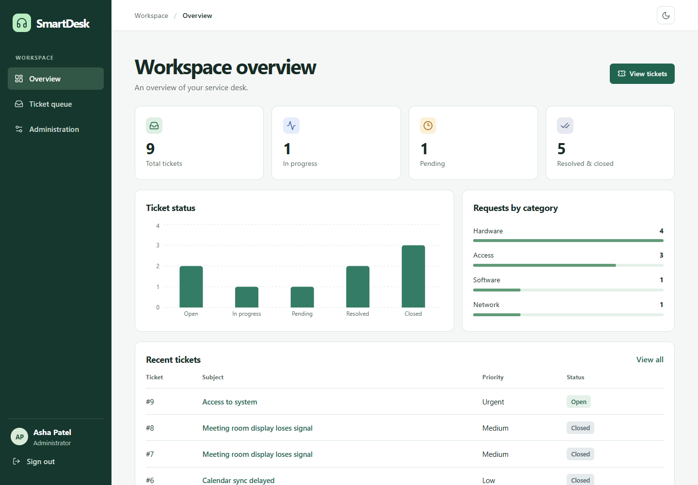
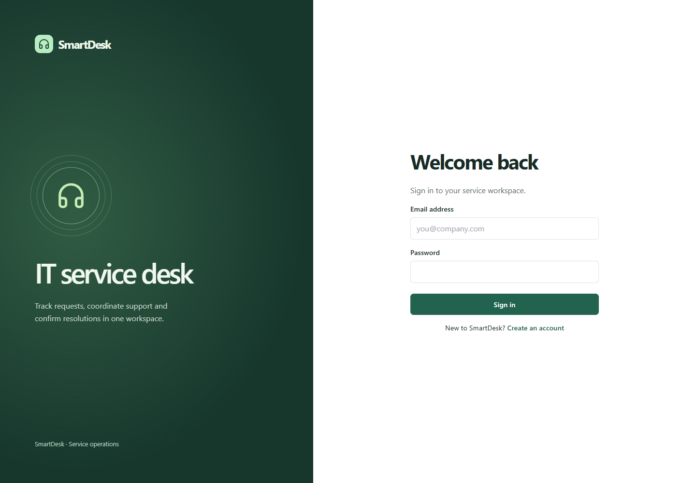
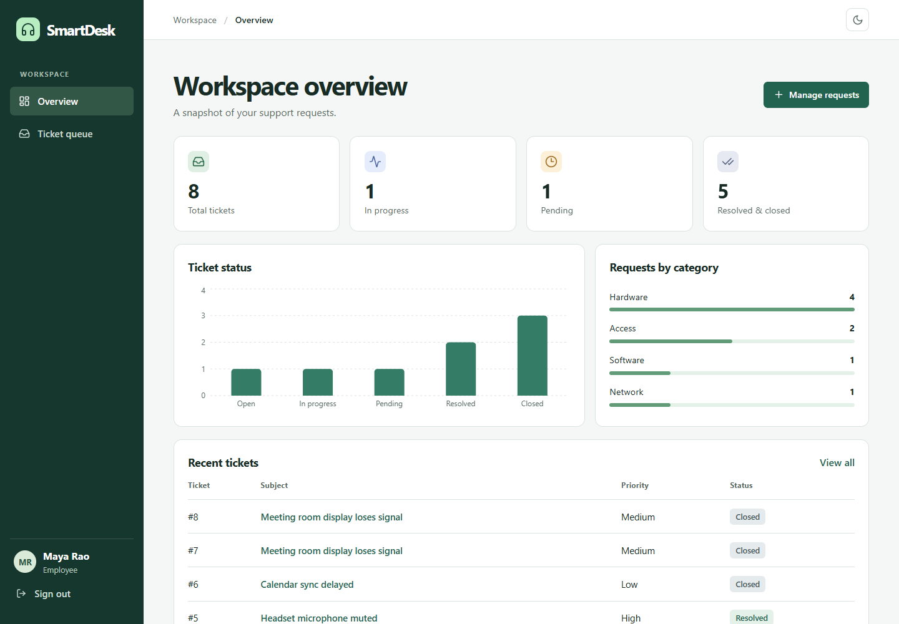
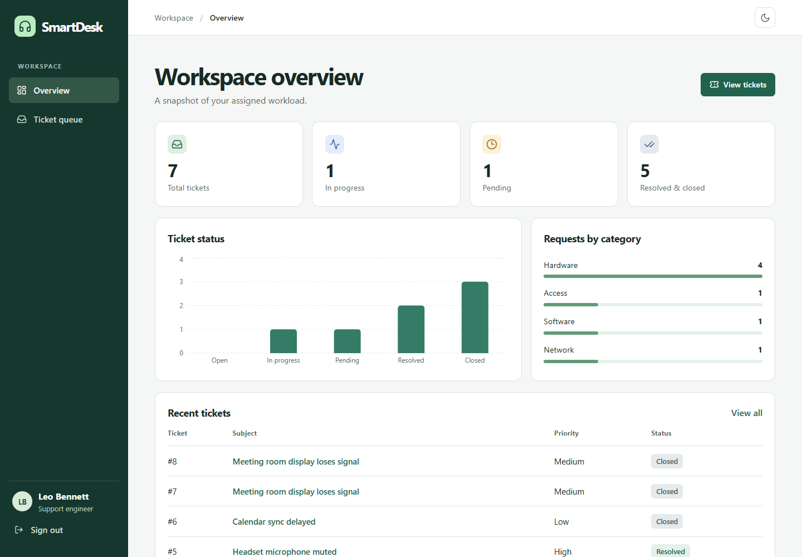
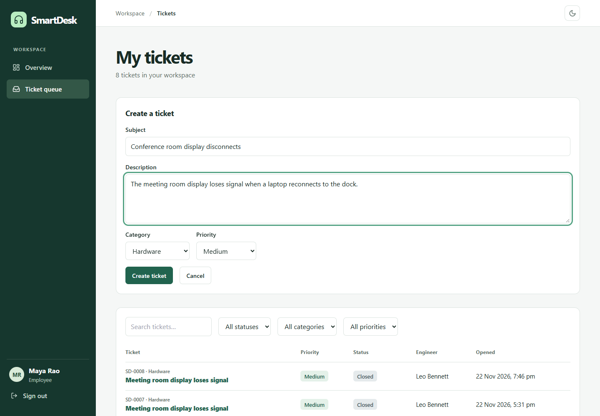
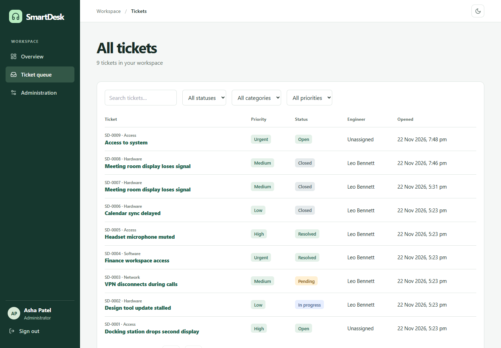
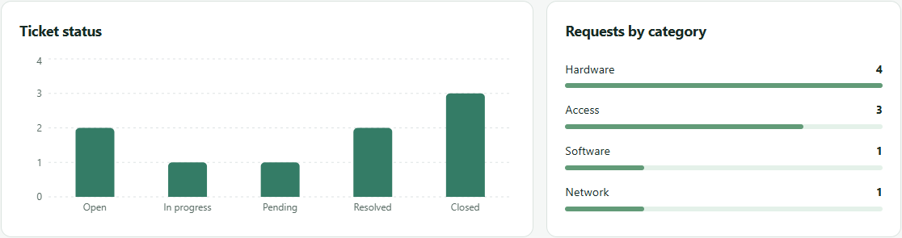
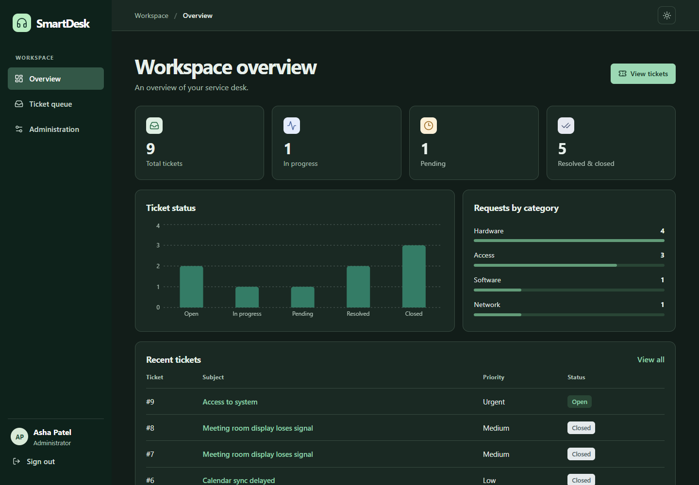

# SmartDesk

SmartDesk is an IT helpdesk application for employees, support engineers and administrators. An employee opens a ticket, an administrator assigns it, and the assigned engineer records progress and a resolution. The employee confirms the fix to close the ticket. Each ticket retains the conversation and a dated history of changes.



## Application tour

| Sign in | Employee workspace |
| --- | --- |
|  |  |
| **Support engineer workspace** | **Ticket creation** |
|  |  |
| **Ticket management** | **Dashboard analytics** |
|  |  |



## Run on Windows

Open PowerShell in the SmartDesk directory. The project targets Java 21 and uses Maven, Node.js with npm, and Git. The scripts discover common JDK, IntelliJ-bundled Maven and MySQL installations on Windows. Set `JAVA_HOME`, `MAVEN_HOME` or `MYSQL_HOME` to select a different installation.

```powershell
.\scripts\Verify-Environment.ps1
.\scripts\Install-Dependencies.ps1
.\scripts\Setup-Database.ps1
.\scripts\Start-App.ps1 -Database mysql
```

The installer runs the backend tests, packages the Java application, installs the locked frontend dependencies and builds the frontend. Database setup starts an isolated MySQL process on loopback port **33316** and creates its data directory under `.tools/mysql-data`. The application applies the versioned schema migrations on startup. On later launches, run just `.\scripts\Start-App.ps1 -Database mysql`. If you change Java source, rerun the installer to rebuild the JAR.

Open [SmartDesk](http://127.0.0.1:5173). Vite proxies requests under `/api` to the [Spring Boot API](http://127.0.0.1:8080/api/me). The API requires a bearer token. Startup logs are in `.tools/Backend.*.log` and `.tools/Frontend.*.log`. To run services interactively, launch `.\scripts\Start-Backend.ps1 -Database mysql` and `.\scripts\Start-Frontend.ps1` in separate terminals.

**In-memory demo.** After installing dependencies, use `.\scripts\Start-App.ps1 -Database demo` to run with H2. This profile recreates its data after each backend restart.

**Existing MySQL server.** Run `.\scripts\Setup-Database.ps1 -ExistingServer -Server 127.0.0.1 -Port 3306 -AdminUser root` to create the schema. MySQL prompts for the administrator password. Grant an application account privileges on `smartdesk.*`, copy `.env.example` to `.env`, and set `DB_URL`, `DB_USER` and `DB_PASSWORD` before launching with `-Database mysql`.

## Demo accounts

The first startup against an empty database seeds six fictional tickets and the following accounts when `DEMO_PASSWORD` is configured. Setup generates the demo password and JWT signing secret locally. Open the ignored `.env.local` file and use the value beside `DEMO_PASSWORD` at login. If you supplied an override, use the value from the first seed. Changing it later does not reset existing accounts. Keep all environment files private.

| Role | Email | What to demonstrate |
| --- | --- | --- |
| Employee | employee@smartdesk.test | Open a ticket, add a comment and confirm a resolution. |
| Support engineer | engineer@smartdesk.test | Review assigned work, update progress and record a resolution note. |
| Administrator | admin@smartdesk.test | Assign a ticket, manage accounts and catalog entries, and export a CSV report. |

Public registration creates employee accounts. For the browser workflow test, run `.\scripts\Test-Browser.ps1` with the app running. The test exercises the application through the browser and writes demonstration records, so use a demo database.

## Repository

| Directory | Contents |
| --- | --- |
| `backend/` | Java 21, Spring Boot 3.5, Spring Security, JWT, Spring Data JPA, Flyway, JUnit and Mockito |
| `frontend/` | React, Vite, Tailwind CSS, Axios, React Router and Recharts |
| `database/migrations/` | Versioned MySQL schema and relational constraints |
| `scripts/` | Windows setup, startup and browser verification |
| `documentation/` | Application design, API reference and interview materials |

The backend uses Spring Boot 3.5.16, the final public 3.5.x release. Continued vendor support for that line requires commercial coverage. [Spring release announcement](https://spring.io/blog/2026/06/25/spring-boot-3-5-16-available-now/)

## Explore the project

- [Architecture and entity relationships](documentation/architecture.md)
- [Role workflows and features](documentation/features.md)
- [HTTP API reference](documentation/api.md) and [Postman collection](documentation/SmartDesk.postman_collection.json)
- [Recruiter demonstration, introduction and resume bullets](documentation/recruiter-guide.md)
- [Project and technical interview questions](documentation/interview-questions.md)
- [Final verification and compatibility notes](docs/qa.md)
