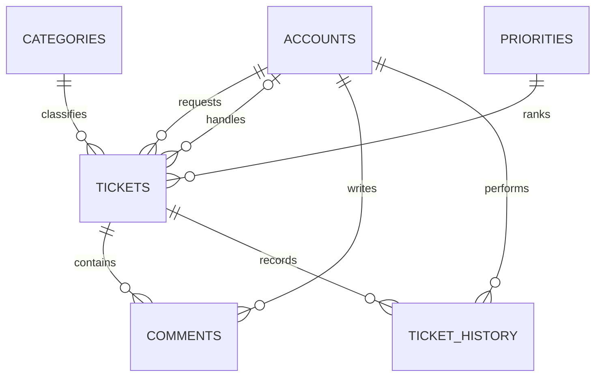

# Architecture and relational model

The local browser sends requests to Vite's same-origin /api proxy. Spring Security validates the token signature, issuer and expiry, then loads the current account and its role for each request. Controllers validate JSON input. TicketService checks ownership or assignment and performs mutations within database transactions. Spring Data JPA persists the changes through Hibernate. Flyway initializes MySQL from the versioned SQL under database/migrations.

**Consistency.** Assignment locks the engineer and ticket records. State changes lock the ticket before checking its current status. A failed transition rolls back the status and its audit entry together. The database enforces unique emails, catalog names and foreign keys. Ticket indexes support owner and engineer queues.

**Reporting.** The UI derives role-scoped statistics, search results and pages from the authorized ticket list. CSV export uses the administrator endpoint, quotes cells and protects formula prefixes. For larger installations, move filtering, aggregation and pagination into database queries.

**Profiles.** MySQL stores the local portfolio data across restarts. The demo profile creates an in-memory H2 database for disposable runs and integration tests. The sample account password comes from the environment and BCrypt generates separate salted hashes. Seeding skips account creation when users already exist.
